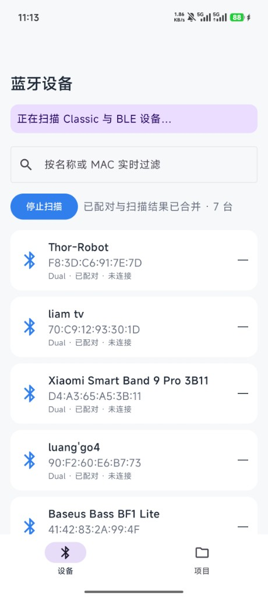
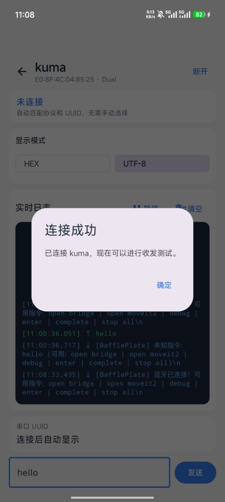
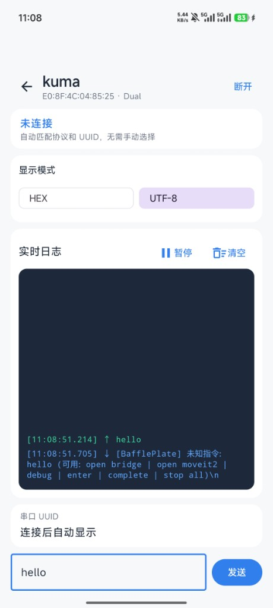
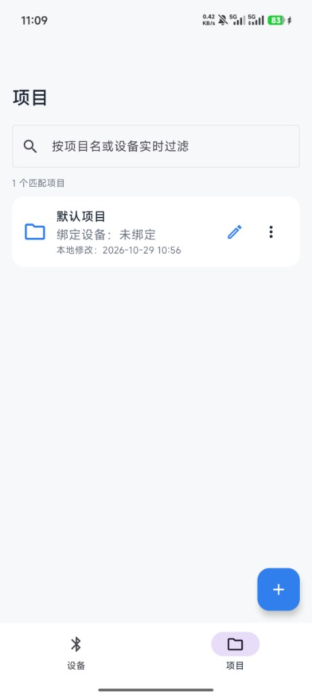
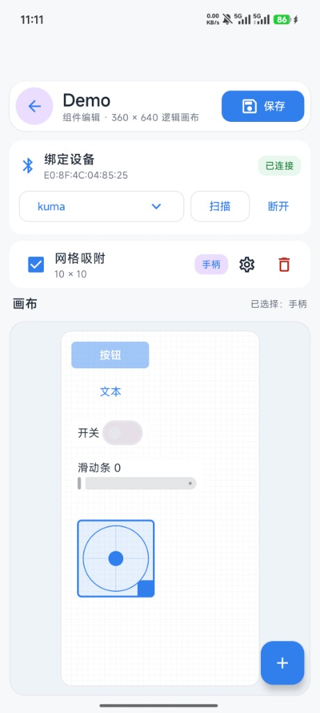
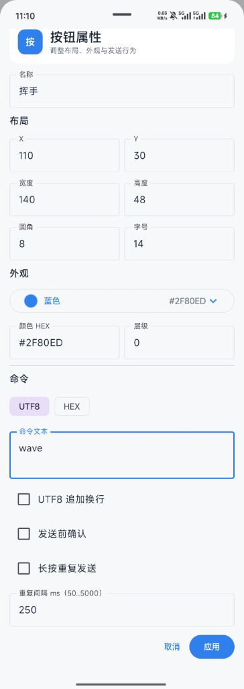
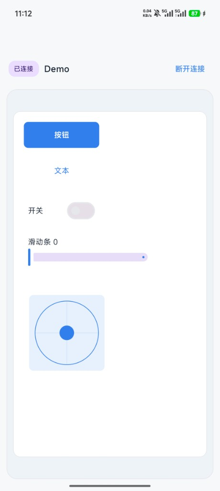

# 蓝牙调试助手

一个开源透明、无广告、无账号系统的原生 Android 蓝牙调试工具，同时支持 Bluetooth Classic RFCOMM/SPP 和 BLE GATT，适用于电脑、单片机、开发板和串口蓝牙模块。

## 开源、安全与隐私

- 完整源代码公开，可以自行检查权限、蓝牙连接和数据存储逻辑。
- 不申请联网权限，不包含广告、统计埋点、账号登录、付费 SDK 或远程控制代码。
- 不使用 Root、私有 API 或反射连接指定 RFCOMM channel。
- 蓝牙数据只在目标设备与手机之间传输；项目配置仅使用 Room 保存在本机。
- 只申请蓝牙扫描、蓝牙连接以及旧版 Android 扫描所必需的位置权限。
- APK 可直接从本仓库源代码复现构建，欢迎在安装前自行查毒、审计和校验。

## 实机展示







## 功能

- 同时扫描 Classic 与 BLE 设备，并按设备类型自动选择连接方式
- BLE GATT 服务发现，自动选择可写/通知特征，并优先识别 Nordic UART Service
- Classic 系统配对、SDP UUID 自动发现和 RFCOMM/SPP 连接
- UTF-8/HEX 串口收发及最多 500 条的 RX/TX 控制台
- 5 个自定义控制面板，可添加按钮、文本、开关、滑动条和手柄
- 编辑/运行模式隔离、串行写队列、长按停止保护和连续控件限频
- Room 持久化；首次启动创建一个不绑定设备的空白“默认项目”
- 拉下通知栏、进入最近任务或短暂切换其他 App 时，不会主动断开现有连接

> 本项目不创建后台常驻服务。Android 强制停止 App、系统回收进程、重启手机、关闭蓝牙或设备离开通信范围时，连接仍会断开；重新进入 App 后会按当前设备自动连接。

## 技术栈与结构

- Kotlin、Jetpack Compose、Material 3、Navigation Compose
- ViewModel、StateFlow、Coroutines
- Room、Kotlin Serialization
- 手动依赖注入，不使用 Hilt
- `bluetooth/`：Classic RFCOMM、BLE GATT 控制器、状态机和 Fake 实现
- `project/`：项目模型、Room 数据层和布局序列化
- 根 UI 包：设备、项目、编辑器及 RX/TX 控制台

## 构建

准备 JDK 17 和 Android SDK API 36。`minSdk 26`，`compileSdk/targetSdk 36`。将 `JAVA_HOME` 指向本机 JDK 安装目录；使用 Android Studio 打开项目并配置 SDK，或设置 `ANDROID_HOME` 指向本机 Android SDK。也可以在项目根目录创建 `local.properties`，设置 `sdk.dir` 为本机 SDK 路径（Windows 路径建议使用 `/`）。此文件已被 Git 忽略，不应上传。

先克隆项目并进入项目目录：

```bash
git clone https://github.com/ChuangjianLiang/BluetoothDebugAssistant_Android.git
cd BluetoothDebugAssistant_Android
```

Windows PowerShell：

```powershell
.\gradlew.bat assembleDebug
# 可选：运行单元测试和静态检查
.\gradlew.bat testDebugUnitTest lintRelease
```

Linux / macOS：

```bash
chmod +x gradlew
./gradlew assembleDebug
# 可选：运行单元测试和静态检查
./gradlew testDebugUnitTest lintRelease
```

调试安装包输出至 `app/build/outputs/apk/debug/app-debug.apk`。首次构建需要联网下载 Gradle 和依赖。

### 正式版签名与发布

当前版本为 1.1.1。正式安装包通过 [GitHub Releases](https://github.com/ChuangjianLiang/BluetoothDebugAssistant_Android/releases) 分发，APK 不纳入源码提交。

如需自行构建签名正式版，请先生成并妥善保管自己的签名密钥，在项目根目录创建 `keystore.properties`：

```properties
storeFile=/path/to/your/release.jks
storePassword=YOUR_STORE_PASSWORD
keyAlias=YOUR_KEY_ALIAS
keyPassword=YOUR_KEY_PASSWORD
```

将以上占位值替换为自己的配置，Windows 密钥路径同样建议使用 `/`。然后运行：

```powershell
# Windows PowerShell
.\gradlew.bat assembleRelease
```

```bash
# Linux / macOS
./gradlew assembleRelease
```

已配置签名时，输出文件为 `app/build/outputs/apk/release/app-release.apk`；未配置签名时生成未签名 APK，不能作为可直接安装的正式包分发。

维护者发布时，在 GitHub 仓库中选择 **Releases → Create a new release**，创建与源码提交对应的版本标签（如 `v1.1.1`），填写更新说明，并将已验证的签名 APK 以 `BluetoothDebugAssistant.apk` 的名称添加到附件后发布。

Fake Bluetooth 控制器仅用于自动化测试和本地开发，不再发布单独的演示 APK。

`keystore.properties`、`*.jks` 和 `*.keystore` 已被 Git 忽略，不应上传到 GitHub 或 Release 附件。请安全备份签名密钥和配置；后续版本必须沿用相同签名且满足版本号要求，才能覆盖安装。自行签名的 APK 通常不能直接覆盖官方签名版本。

## 手机安装

### 方式 1（推荐）

打开 [GitHub Releases 下载页](https://github.com/ChuangjianLiang/BluetoothDebugAssistant_Android/releases)，选择所需版本，在 **Assets** 中下载 `BluetoothDebugAssistant.apk` 到手机并点击安装。`Source code` 压缩包是源码，不是安装包。

### 方式 2

先从上述 Releases 页面下载 `BluetoothDebugAssistant.apk`，并在下载目录打开终端。在手机开发者选项中开启“USB 调试”，连接数据线并在手机上允许此电脑：

```bash
adb devices -l
adb install -r BluetoothDebugAssistant.apk
adb shell monkey -p com.kuma.bluetoothdebugassistant 1
```

显示 `unauthorized` 时解锁手机并确认 RSA 授权；没有设备时选择 USB“文件传输”并检查数据线。

## 权限、配对和连接

- Android 12+：允许“附近设备”（`BLUETOOTH_SCAN`、`BLUETOOTH_CONNECT`）。
- Android 11 及以下：蓝牙扫描还需要位置权限，并应开启系统定位。
- App 不请求 `BLUETOOTH_ADVERTISE`，配对由 Android 系统弹窗确认。

操作顺序：

1. 让目标设备可发现，并启动其 BLE GATT 串口服务或 SPP/RFCOMM 服务。
2. 在“设备”页授权并扫描，按名称或 MAC 查找目标。
3. 点击设备后，纯 LE 设备直接使用 GATT；Dual 设备优先尝试 GATT，失败后自动回退 Classic；Classic 设备使用 SDP/RFCOMM。
4. GATT 会优先使用 Nordic UART Service（服务 `6e400001-...`、写 `6e400002-...`、通知 `6e400003-...`），其他设备则自动选择首个可写特征和可通知特征。BLE 通常不需要先在系统中配对。
5. Classic 模式会优先尝试缓存及标准 SPP UUID，必要时自动执行 SDP 搜索，不需要用户手动选择 UUID。
6. 使用 UTF-8 或 HEX（例如 `AA 55 0D 0A`、`0xAA 0x55`）收发数据。

目标端未启动 SPP 服务时，SDP 可能没有标准 UUID；先启动目标端监听，再刷新 UUID。BLE 连接失败通常表示设备未广播、GATT 服务未启动或没有可写特征；Classic 连接被拒绝通常表示 UUID 不匹配、服务未监听或配对失效。

## 支持自定义项目

“项目”页支持新增、重命名、复制、编辑、删除及绑定设备。点击项目会自动连接绑定设备并进入全屏运行模式；点击卡片右侧铅笔进入组件编辑。编辑模式不会发送命令，运行模式不会拖动控件。命令可选择 UTF-8/HEX，UTF-8 可自动追加换行，也可启用发送前确认或按钮长按重复。

## 支持作者

项目完全免费，如果这个工具对你有帮助，可以支持一下呦～


